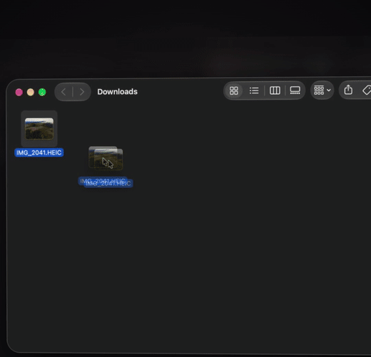
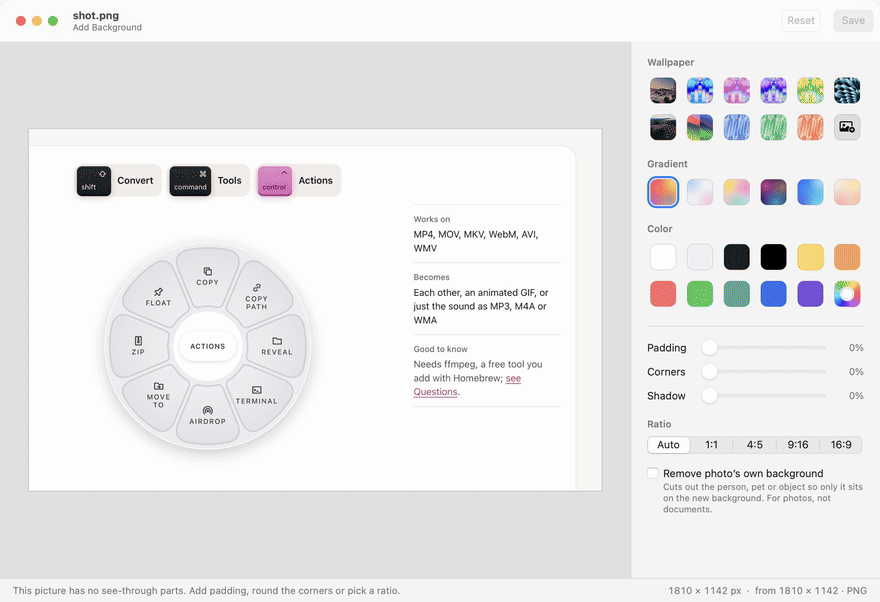
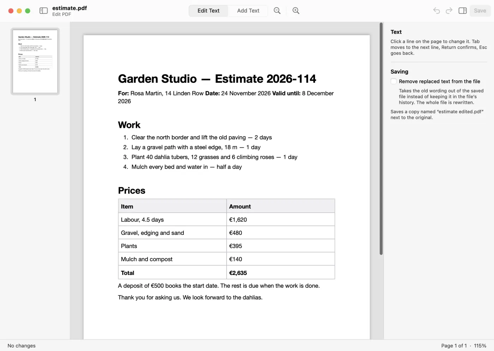
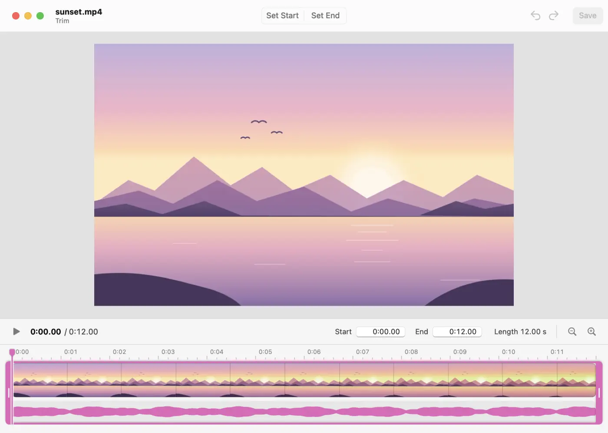
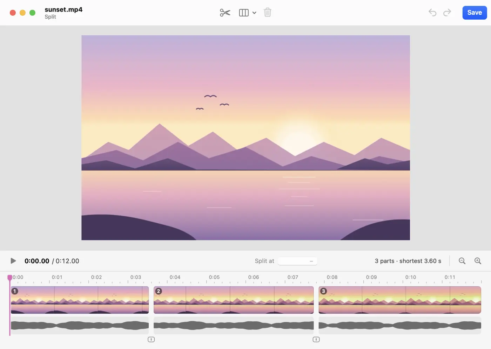
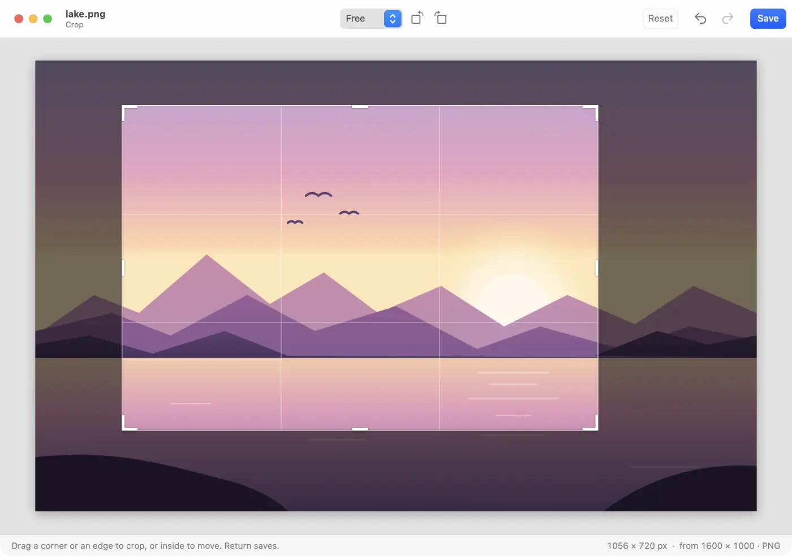
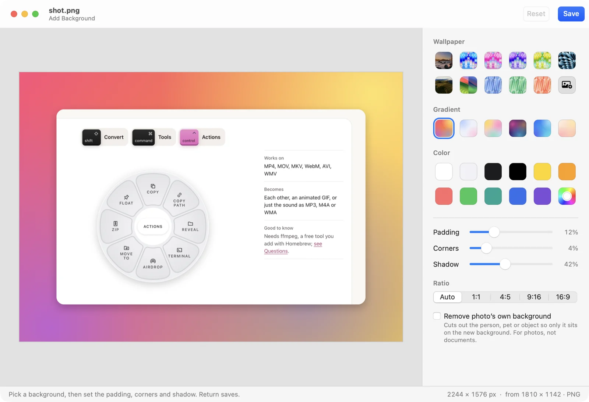
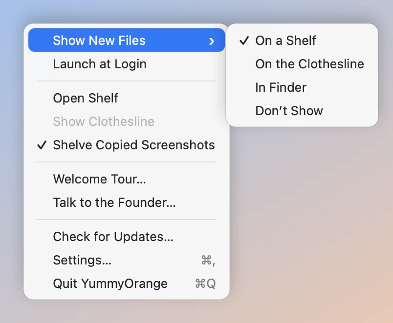
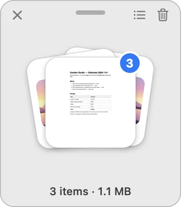

# YummyOrange

Website: [yummyorange.com](https://yummyorange.com)

<p align="center">
  
</p>

<p align="center"><b>Drag a file, tap a key, drop it on a petal.</b> The new file is saved next to the original.</p>

A menu-bar file converter driven by a gesture: **drag files, press a modifier key, and drop them on a wheel.** It is an original implementation of the interaction studied in [`../Tangerine`](../Tangerine/REPORT.md): it follows that app's decompiled gesture rules and measured design, but contains none of its code, assets or wording.

## See it

**Add Background:** put any picture on one of your Mac's wallpapers, a gradient or a colour, with padding, rounded corners and a soft shadow. The live preview is drawn by the same code that saves the file.

<p align="center"></p>

**The Clothesline:** new files hang under the notch for a moment. Rest the pointer there to see them again, and drag any card out.

<p align="center"></p>

| Edit PDF | Trim |
|---|---|
| <picture><source media="(prefers-color-scheme: dark)" srcset="docs/media/ed-pdf-dark.webp"></picture> | <picture><source media="(prefers-color-scheme: dark)" srcset="docs/media/ed-trim-dark.webp"></picture> |
| **Split** | **Crop** |
| <picture><source media="(prefers-color-scheme: dark)" srcset="docs/media/ed-split-dark.webp"></picture> | <picture><source media="(prefers-color-scheme: dark)" srcset="docs/media/ed-crop-dark.webp"></picture> |

| Add Background | Menu bar | Your shelf |
|---|---|---|
| <picture><source media="(prefers-color-scheme: dark)" srcset="docs/media/add-background-dark.webp"></picture> | <picture><source media="(prefers-color-scheme: dark)" srcset="docs/media/menu-dark.webp"></picture> | <picture><source media="(prefers-color-scheme: dark)" srcset="docs/media/shelf-dark.webp"></picture> |

Screenshots follow your GitHub theme (light or dark).

## The three wheels

| Key | Wheel | Offers |
|---|---|---|
| **⇧ Shift** | Convert | **Images** → JPG, PNG, HEIC, WebP\*, TIFF, AVIF, GIF, BMP, PDF, PPTX (one slide each) · **Video** → MP4, MOV, MKV, WebM, AVI, WMV, GIF, MP3, M4A, WMA · **Audio** → MP3, M4A, WAV, FLAC, OGG, Opus, AIFF, WMA · **PDF** → PNG, JPG, SVG, DOCX, TXT and Markdown (reflowed text, OCR for scans), EPUB, PPTX, XLSX · **Documents** (DOCX, DOC, RTF, HTML, TXT, Markdown, ODT) → PDF and each other, EPUB · **EPUB, Pages** → PDF, DOCX, TXT, Markdown, HTML, RTF, EPUB · **PowerPoint** (PPTX, PPT) → PDF, PNG, JPG, PPTX · **Spreadsheets** (XLSX, XLS, ODS, CSV, TSV) → each other and PDF · **Subtitles** SRT ↔ VTT, → TXT · **Folders and mixed selections** → ZIP, TAR, GZIP |
| **⌘ Command** | Tools | **Images:** Compress, Compress to… (a size in MB), Resize…, Add Frame…, Collage (2+), Adjust… (exposure, contrast and more, with a live preview), Annotate… (arrows, shapes, pen, highlighter, text), Crop… (aspect presets, quarter turns), Redact… (black, blur or pixelate boxes; Find Text and Find Faces suggest them; the copy has no metadata), Add Background… (a window with a live preview: the Mac's wallpapers, gradients, colours or any picture behind it, with padding, rounded corners and a drop shadow, on an Auto/1:1/4:5/9:16/16:9 canvas; Remove photo’s own background cuts out the subject on macOS 14+), Read QR Code, Strip Metadata, Half Size, Rotate 90°, Extract Text, Make PDF · **PDF:** Edit PDF… (change a line's text in place in its own font, add text; saves “name edited.pdf” as an incremental update, so the original bytes and layout stay), Organize… (page grid: reorder, rotate, duplicate, delete, insert), PDF/A, Compress, Compress to…, Strip Metadata, Rotate, Split Pages, Extract Text, Add/Remove Password, Merge (2+) · **Video and audio:** Trim… (a window with a film strip or waveform, in/out handles and exact, frame-accurate cuts in the file's own format), Bleep… (tone or silence over ranges you mark), Speed… (0.25× to 4×, pitch kept), Split… (a window like a video editor's: put splits on the timeline with the scissors or ⌘B, or split evenly; saves each part), Channels… (one file: mono, stereo, swap, left, right), Merge (2+ videos or 2+ sounds: one new file in the order they were dropped; lossless when the videos match, otherwise fitted to the first one’s size and frame rate), Compress, Compress to…, Strip Metadata, Mute, Extract Audio, Normalize · **Video only:** Crop… (a crop frame over the picture), Redact… (blur, pixelate or black boxes, each for a time range), Snapshot… (the exact frame as a full-size PNG) · **Audio only:** Visualize… (waveform, spectrum or bars as an MP4) · **Archives:** Extract (ZIP, TAR, TGZ, BZ2, XZ, 7Z, RAR read-only) · **Slides:** Slide Text |
| **⌥ Option** | Actions | Copy, Copy Path, Reveal, Terminal, AirDrop, Move To…, Zip, Float (a shelf that keeps files at hand) |

**How to open a wheel.**
- Start dragging, then press the key. You can also hold the key first, then drag. You can let go of the key once the wheel is up.
- Pressing another wheel's key switches wheels. **Esc** closes the wheel, and **,** (comma) opens Settings.
- ⌥ Option has been the Actions key since 1.0.1 (it was ⌃ Control, which macOS reads as a right-click when held before the drag). While no wheel uses ⌃, tapping ⌃ mid-drag still opens the ⌥ wheel (Actions, with the default keys), unless you saved a key map without ⌃ before 1.0.1. If you give a wheel ⌃ and no wheel uses ⌥ (Actions moved to ⌃, say), ⌥ opens it too and can be held before dragging. A key map you saved yourself keeps its keys.
- When a file is already selected, Finder treats ⇧- or ⌘-press on it as "deselect", so no drag starts. Turn on **Settings › Wheels › Hold the key first** to fix that (see below).

Results are saved next to the original as `name.ext`, then `name 2.ext`, and so on; the input is never changed. When a job finishes, its new files go on **your shelf** (every file it made, even if some inputs failed), which comes forward ready to drag on; **Open Shelf** in the menu-bar menu shows it any time, and it keeps its files when closed and across launches. **Settings › General › Show new files** (or **Show New Files** in the menu-bar menu) switches this to **On the Clothesline**, **In Finder** (select them in a Finder window, the old behaviour) or **Don’t Show**. On the Clothesline, each job's files hang from a string under the notch (under the middle of the menu bar on a display without one), swing, and after 2 seconds the string pulls up into the notch. Rest the pointer on the notch (or the middle of the menu bar), or choose **Show Clothesline** in the menu-bar menu, to drop it again with the files on it: the newest 50, less any you removed or deleted. Scroll the cards sideways with two fingers; double-click a card to open it, drag it out, or right-click it for Open, Show in Finder, Copy, Remove from Line and Clear Line. Click a card to select it: it wears a ring in YummyOrange's accent, the line stays out, and the line takes the keyboard without bringing YummyOrange forward. Delete (or Forward Delete) takes it off the line, as Remove from Line does (the file stays where it is), and the selection moves to the card that takes its place; ⌘Z right after puts it back; ← and → move the selection; Esc or a click anywhere else ends it. An empty line holds a welcome card, a picture YummyOrange draws itself (“Drag files up to the notch”, written once to ~/Library/Application Support/YummyOrange/Clothesline); it hangs like any file, new files hang in front of it, and once you take it off the line it never comes back. You can also hang files yourself: drag any file or folder to the notch and hold it there a moment, and the line drops (even an empty one) with the card to be, translucent with an open clothespin, showing where it will hang; the cards around it make room as you move along the string (past the last card it waits at the end of the row, which is where the file will stay). Once it is over the line you can let go anywhere over it, not only on the string: across its whole width, from the top of the screen down past the bottom of the cards; the line stays out while the file is there, and goes a moment (0.35 s) after you take the file away, coming back if you bring it toward the notch again (or back over the line before it has gone). Let go and the card fades in right there and its pin closes on the string. The file stays where it is (the line only keeps a reference to it), so later you can rest on the notch, grab its card and drag it into any Finder folder: on the same disk that moves the file there, and the card follows it. Press and drag a card along the string to move it: it lifts off and hangs from its pin under the pointer, the cards around it make room where it will go (near either end of a long line it scrolls), and when you let go its pin catches the string there and the new order stays; Esc puts it back. Drag it down off the line and it becomes the file drag to Finder; the line goes, and comes back if you bring the card back toward the notch, where letting go moves it (it never hangs twice). VoiceOver offers Move Left and Move Right on each card and says where it went. Photos, Mail attachments and Safari images, which apps only promise until they are dropped, are written into a YummyOrange folder in the temporary directory and hang from there. A drag with ⌥ held (a copy) is left alone. Choosing another place for new files puts the line away; choosing On the Clothesline again hangs its files back. The corner banner appears only for errors and for jobs that run longer than 1.5 seconds (Settings › Show progress shows it for every job); while new files go to the line, it sits under the line's cards. If you had turned off the old “Reveal results in Finder”, you start on Don’t Show. Each key can be changed or turned off in Settings, which also has the wheel's look (Glass or Metallic), the petal sound (Dial, Click, Wood, Pop or Glass, or off) and haptics.

**Hang copied screenshots** (Settings › General, on by default, right under Show new files; also in the menu-bar menu) hangs a screenshot on the Clothesline when you copy it, or, On a Shelf, puts it on your shelf (**Shelve Copied Screenshots**), even while the shelf is closed. It is dimmed for In Finder and Don’t Show. Taking a screenshot that macOS only saves to a file hangs nothing.

- **What counts.** ⌘C in macOS's floating thumbnail or its Markup window, or a screenshot taken with Control held (or with the Screenshot app set to Clipboard), while macOS's screenshot helper is at work. Only the first image of each screenshot hangs (pressing ⌘C again adds nothing), never one identical to the last one, and an image copied anywhere else hangs nothing.
- **Where it goes.** The image is saved as a PNG named the way macOS names screenshots, in your language, in **Pictures › Clothesline**, and its card flies up from the pointer; the clipboard is left as it was. Copied on another display, the card comes in from the right edge of the line's display.
- **Permission.** macOS asks before YummyOrange can paste from the screenshot helper, right after the first copied screenshot. If you decline, copied screenshots are skipped (Settings says so) until the switch is turned off and on again; if YummyOrange is set to Deny in System Settings › Privacy & Security › Paste from Other Apps, they are skipped until you allow it there.
- While the line is out for a screenshot it is left out of screen captures, and so is the flying card, so your next screenshot doesn't catch them. Otherwise the line can be captured like any window.
- With Reduce Motion on, the card fades in on the line instead of flying.

**Links from YouTube, X, Instagram, TikTok and Threads.** Drag a post's address out of the browser's address bar (or drag a link or thumbnail on the page) and press ⇧: the Convert wheel opens with **MP4, MP3, M4A and WAV**. Drop it on one and the post's video, or just its sound, is saved in **Downloads**, named after the post, and shown like any new file. A `.webloc` link file dragged from Finder works the same way and saves next to itself. Only the Convert wheel opens for a dragged link.

- **How.** Threads posts load in a hidden web view, with no sign-in and nothing kept, which gives the video's address. The other four sites go through [yt-dlp](https://github.com/yt-dlp/yt-dlp): the first time, YummyOrange asks before downloading its macOS build (about 37 MB) from yt-dlp's GitHub releases into `~/Library/Application Support/YummyOrange/Helpers/yt-dlp`, and keeps it only if it matches the published SHA-256. A yt-dlp already in `~/.local/bin`, `/opt/homebrew/bin`, `/usr/local/bin` or `/usr/bin` is used when YummyOrange has none of its own. yt-dlp only fetches; YummyOrange's own ffmpeg recipes make the MP3 (192 kb/s), M4A (AAC, kept as it is when it already is) and WAV, tagged with the post's title and author. When a download fails, YummyOrange's copy updates itself (at most every six hours) and tries once more.
- **Signed-in posts.** When a site shows a post only to signed-in visitors, YummyOrange asks, every time, whether yt-dlp may use your sign-in from the browser the link came from (Chrome, Brave, Edge, Firefox, Vivaldi, Opera; not Safari, whose cookies need Full Disk Access), and then tries once more with that browser's cookies, sent only to that site; macOS may ask first. If you say no, or it fails too, the banner says to sign in to the site in one of those browsers and drag the link again. On the command line, `--opt cookies=1` allows it.
- **Only what you're allowed to.** Download your own posts, or posts whose owner allows it. YouTube's terms allow downloads only where YouTube offers them, and music in posts is usually copyrighted.
- From the command line: `DropWheel --convert mp3 --opt getYtDlp=1 link.webloc` (`getYtDlp=1` lets it download yt-dlp when there is none). `--selftest links` checks the address rules and link files offline.

\*WebP output needs `cwebp` or an ffmpeg built with libwebp. Audio and video need `ffmpeg`. YummyOrange uses one already on the Mac (in `~/.local/bin`, `/opt/homebrew/bin`, `/usr/local/bin` or `/usr/bin`, or bundled in `Contents/Resources/Tools`); on a Mac without one it downloads its own LGPL build once (11.5 MB, `FFmpegHelper.swift`) into `~/Library/Application Support/YummyOrange/Helpers`, a minute after launch on a network that isn't metered, or when a task needs it. `Tools/helpers/build-ffmpeg-helper.sh` makes that build; it, its source tarballs and its licenses are published in `Website/public/downloads/helpers/` and on `licenses/ffmpeg.html`.

## Build, run, test

```bash
./build.sh
```

```bash
open build/YummyOrange.app
```

```bash
./test.sh
```

- **Names:** the app is `YummyOrange.app` (bundle identifier `com.yummyorange.app`, executable `YummyOrange`, log subsystem `com.yummyorange.app`). The code keeps its internal name, DropWheel: the SwiftPM target and product, `Sources/DropWheel`, `.build/debug/DropWheel` and type names. `build.sh` writes `build/YummyOrange.app` and leaves a `build/DropWheel.app` from before the rename alone. A new bundle identifier is a new app to macOS: settings, Login Items and the Accessibility permission start over, and a copy built as `local.dropwheel` can't update to `com.yummyorange.app`.

- **Requirements:** macOS 13 or later, and Swift (Xcode or the Command Line Tools).
- **Signing:** `build.sh` signs with your Apple Development identity when there is one, otherwise ad hoc. A stable identity keeps the Accessibility permission across rebuilds.
- **Size:** `build.sh` builds the release optimized for size (`-Osize`) and strips local symbols; the self-tests (`*Tests.swift`, `*SelfTest.swift`) are built into debug builds only (`#if DEBUG`), which is what `./test.sh` uses. The app is about 7.4 MB (1.0.11): a 6.59 MB program (6,588,128 bytes, stripped; link downloads added about 67 KB) and its 1.1 MB icon; the update ZIP is 4.4 MB. yt-dlp (about 37 MB) is never in the app: it is downloaded only when someone first drops a YouTube, X, Instagram or TikTok link and agrees.
- **Not sandboxed**, so YummyOrange can write next to any file without an Open panel or folder bookmarks. macOS still asks once before it writes in the Desktop, Documents or Downloads folder or on an external or network drive; the Info.plist says why (`NS…UsageDescription`). It sends no Apple Events, so it needs no Automation permission.
- **Version:** `build.sh` writes version 1.0.0, build 1 into the Info.plist. `VERSION=1.0.1 BUILD_NUMBER=7 ./build.sh` sets others (up to three numbers joined by dots). The Info.plist also has the copyright line and the Productivity category, and keeps `LSUIElement`: no Dock icon until one of YummyOrange's windows opens (an editor, the PDF organizer, Settings), when it joins the Dock and the app switcher until the last one closes (`DockPresence.swift`).
- **Updates:** `build.sh` writes the update feed's address (`UPDATE_FEED_URL`) and, when given, the update key (`UPDATE_PUBLIC_KEY`) into the Info.plist; `SIGN_IDENTITY` signs a release with the hardened runtime and a timestamp (`-`: ad hoc with the hardened runtime, the app release.sh hands to Xcode for Developer ID signing), and `BUILD_DIR` builds somewhere other than `build/`. See [Updates and releases](#updates-and-releases).
- **`./test.sh`** takes ten to fifteen minutes (the media suites run ffmpeg many times). It builds (or, with `DW_TEST_BIN=<debug binary>`, tests a binary built elsewhere), then runs these, writing outputs to a new temporary folder outside iCloud:
  - the original-features regression: 51 checks in `Tests/regress-core.sh`
  - one run of every newer command: 120 checks in `Tests/features.sh`
  - every module's self-test: 44 suites
  - the two regressions and the media suites again with YummyOrange's own LGPL ffmpeg (no libx264, boxblur or dav1d), unpacked from the pinned ZIP in `Website/public/downloads/helpers/` after its SHA-256 is checked against `FFmpegHelper.pinnedBuild`, with this Mac's ffmpeg hidden

### Command-line mode

```bash
.build/debug/DropWheel --targets photo.png
```

```bash
.build/debug/DropWheel --convert docx report.pdf
```

```bash
.build/debug/DropWheel --tool resize --opt mode=width --opt value=1200 photo.png
```

```bash
.build/debug/DropWheel --selftest gesture
```

`--list` prints every module command. `--snapshot <id> <out.png>` renders a window offscreen (`--snapshot menu` draws the menu-bar menu with Show New Files open; `--snapshot settings-window --opt section=wheels` draws the whole Settings window, title bar and toolbar included). Settings-type options for `--snapshot settings|settings-window|wheel|menu` (and `welcome`, for style, keys and results) apply to that render only: `--opt results=shelf|clothesline|finder|none` (the older `--opt reveal=on|off` still works: on is In Finder, off is Don’t Show), `style`, `convert`/`tools`/`actions`, `sounds`, `haptics`, `progress`, `screenshots` (Hang copied screenshots). Shelves and Finder windows never open from the command line, self-tests or snapshots. `--petal-sounds <folder>` writes each petal sound as a WAV, plus a slow-fast-slow sweep.

## Updates and releases

YummyOrange updates itself with its own code (`Updater.swift`, no Sparkle or other package). It reads a small JSON feed on the website, `Website/public/updates/appcast.json`, signed with the update key in `appcast.json.sig` next to it, served at `https://yummyorange.com/updates/appcast.json`. That address is pinned as `FEED_URL` in `Tools/updates/release-identity` and built into every copy (copies already out keep asking the address they were built with). It is on yummyorange.com, a domain YummyOrange owns: a `vercel.app` name that is given up can be claimed by someone else, and every copy built with it would keep asking them.

**What the app does.**
- **When it checks:** 10 s after launch, then every hour, and 30 s after the Mac wakes if the last check is an hour old or more. A check that gets no answer (offline, say) doesn't count: the next is tried 15 minutes later. **Settings › General › Check for updates automatically** (on by default) turns this off. **Check for Updates…** in the menu-bar menu (above Settings…) always works and always answers: the update alert, “You’re up to date.”, or what went wrong.
- **How it asks:** two requests, the feed and its signature (`appcast.json.sig`), in an ephemeral session (no cookies, cache or stored credentials), HTTPS only (plain HTTP only to this Mac, for tests), redirects only to HTTPS, 15 s per request and 30 s in all, at most 64 KB of feed and 1 KB of signature. The feed is read only once its **Ed25519 signature** (against `DWUpdatePublicKey`) checks out, and its download and release-notes addresses must be on the feed's own site, so whoever could change the website without the key can't change the release notes, the link in the update alert or where the download comes from. The requests name the app and its version (`User-Agent: YummyOrange/1.0.0`); their other headers are the same for every copy (`Accept: */*`, `Accept-Language: en`, `Accept-Encoding: gzip, deflate`). Installing also lets macOS check the new version's certificate with Apple (a revocation check), as it does for any signed app.
- **What counts as an update:** a higher **build** (`CFBundleVersion`), never the same or a lower one, and only when this Mac meets the feed's `minimumSystemVersion`.
- **How it tells you:** a notification, delivered quietly to Notification Center (permission is requested provisionally the first time an update is found, so macOS never puts up a prompt for it; Settings › Notifications can make it a banner), and **Update to YummyOrange 1.0.1…** at the top of the menu-bar menu. Both open the update alert with the release notes: **Install Update**, **Remind Me Later** (quiet for 24 hours) or **Skip This Version** (that build is never announced again; a later one is). Clicking the notification never installs by itself. The notification has the same two actions. Each update is announced once.
- **Installing:** when an editor window (an image, video, sound or PDF editor, or the PDF page organizer) has changes that haven't been saved, YummyOrange first asks whether to restart and lose them (**Not Now** is the default), before the download and again before the swap. The ZIP is downloaded into a temporary folder on the app's own volume (the person's own temporary folder on a disk that ignores ownership), stopping as soon as it passes the feed's `length` (progress shows in the HUD even when Show progress is off). Then, in order: its length, SHA-256 and **Ed25519 signature** (CryptoKit, against `DWUpdatePublicKey`); `ditto -x -k`, after which nothing in the app may belong to another user, and group and other write permission and set-ID bits are taken off (code signatures don't cover file modes); the new app's Info.plist (bundle identifier `com.yummyorange.app`, the feed's version and build, a build above the installed one, a minimum macOS this Mac meets); its **code signature**, strictly (every architecture, nested code, sealed resources, symbolic links only inside the bundle, app-like bundles only) against a requirement for the running app's identifier and team, with the **hardened runtime**. A copy signed with **Developer ID** (every copy from the website) also requires a Developer ID certificate (leaf and intermediate), a **stapled notarization ticket** and **Gatekeeper's** approval to run it (SecAssessment), so a build signed with any other certificate of the team, such as an Apple Development one, is refused. Only then does `FileManager.replaceItemAt` swap the new bundle into the old one's place in one step; the new copy's Info.plist and signature are checked again where it now is, and if that fails the old copy (kept hidden beside it until then) is put back. A `/bin/sh` helper waits for YummyOrange to quit, however long that takes, and opens the new copy; YummyOrange quits once no conversion is running, so none is cut off.
- **When it can't replace itself** (an Applications folder you can't change, a disk image, a disk that ignores ownership such as exFAT, or a copy macOS runs from a temporary translocated folder), the verified new app goes to Downloads as “YummyOrange 1.0.1.app” (or, if macOS keeps YummyOrange out of Downloads, `~/Applications` or a temporary folder), Finder shows it, and an alert says to quit YummyOrange and drag it into Applications.
- **Copies that can't update:** one built without `UPDATE_PUBLIC_KEY`, or signed ad hoc (no team, so it can't tell a genuine update from another app). Check for Updates… says why and the Settings switch is dimmed. An ad-hoc build may update only in the local test mode: a feed on localhost, in a debug build or with `DW_UPDATE_LOCAL_TEST=1`.
- **Permissions after the first Developer ID update:** macOS ties privacy permissions to the app's signature. The first update from a copy signed with Apple Development to one signed with Developer ID changes it, so macOS may ask again for each: Accessibility (Hold the key first), and the Desktop, Documents, Downloads, removable-volume and network-volume folders.

**The feed** (`Tools/updates/make-appcast.swift` writes it, and `release.sh` signs its exact bytes into `appcast.json.sig`, the base64 Ed25519 signature on one line; addresses may be relative to the feed, which is how `release.sh` writes them, so the feed stays right whatever the domain):

```json
{
  "build" : "2",
  "length" : 4178703,
  "minimumSystemVersion" : "13.0",
  "published" : "2026-11-24T12:28:53Z",
  "releaseNotes" : "Faster PDF export.",
  "releaseNotesURL" : "../release-notes.html",
  "sha256" : "5305af42…",
  "signature" : "xeUyfsJE…(base64 Ed25519 signature of the ZIP)",
  "url" : "../downloads/YummyOrange-1.0.1-2.zip",
  "version" : "1.0.1"
}
```

`version`, `build`, `url`, `length`, `sha256` and `signature` are required; the app refuses a feed with any of them missing or malformed, an address on another site, or a missing or wrong `appcast.json.sig`, and ignores keys it doesn't know. An attacker who can change the website but doesn't hold the key can still serve an older signed feed, which holds copies at the version they have (never lower: only a higher build installs) until the site is fixed.

**Once: the update keys and `Tools/updates/release-identity`.**

```bash
swift Tools/updates/make-update-keys.swift ~/.dropwheel/update-signing-key
swift Tools/updates/make-update-keys.swift /Volumes/<a USB stick>/dropwheel-backup-key   # kept off this Mac
```

Each writes a private key to that file, readable by you alone and **encrypted with a passphrase** it asks for twice (PBKDF2-SHA256 and AES-GCM: a copy of the file, in a backup say, is no use without it; never into the Keychain). It refuses an existing file and a path inside the project, on the Desktop, in Documents or in iCloud Drive (compared by the folders' identity, so letter case or Unicode spelling can't slip past), and prints the public key. Put both public keys, separated by a space, in `Tools/updates/release-identity` as `UPDATE_PUBLIC_KEY`, before the first release: copies built with both accept updates signed with either, so if the main key is lost or leaks, release with the backup key and pin a new pair. Back up both and both passphrases: without them the next version has to be downloaded by hand.

`Tools/updates/release-identity` (committed; public values only) pins `TEAM_ID` (37P86CG9SS, the team of this Mac's Apple Development certificate; a Developer ID certificate of the same account carries the same team), `UPDATE_PUBLIC_KEY` and `FEED_URL` (`https://yummyorange.com/updates/appcast.json`). `build.sh` builds with the pinned keys and refuses any others (and a Developer ID identity of another team); `release.sh` refuses another team, another key, a feed address that isn't given or pinned, and a private key path in the project, Desktop, Documents or iCloud Drive.

**Developer ID and notarization: Xcode, or this Mac.** Every release is signed with Developer ID and notarized by Apple, in one of two ways (`SIGNING`):
- **Xcode (`SIGNING=cloud`; the default when this Mac has no Developer ID identity of the pinned team, which is the case now).** Xcode signs with the team's **cloud-managed** Developer ID certificate, whose private key stays with Apple, so this Mac needs no Developer ID certificate; and it sends the app to Apple's notary service with the Apple Account it is signed in to, so there is no notarytool profile or app-specific password either. Once per Mac: install Xcode and sign in to the team's account in Xcode › Settings › Accounts (an Admin or the Account Holder of team 37P86CG9SS). **Keep this Mac unlocked** from the start of a release until Apple has notarized it: Xcode keeps its account where it can be read only while the Mac is unlocked, and on a locked Mac `xcodebuild` finds “No Accounts” and signs nothing (release.sh refuses to start on a locked screen; while it waits for Apple, it keeps waiting through a lock).
  How it works: `build.sh` signs the app ad hoc with the hardened runtime (`SIGN_IDENTITY=-`). release.sh puts it in an Xcode archive it writes itself (`YummyOrange.xcarchive`: `Products/Applications/YummyOrange.app` and an `Info.plist` with `ApplicationProperties`, `ArchiveVersion` 2, `Name` and `SchemeName`), and `xcodebuild -exportArchive -allowProvisioningUpdates` with the export options `method developer-id`, `signingStyle automatic`, `teamID 37P86CG9SS` and `destination upload` signs it with Developer ID (keeping the hardened runtime: Xcode re-signs with `--preserve-metadata=identifier,flags,runtime,…` and adds a secure timestamp) and uploads it to the notary service. Then `xcodebuild -exportNotarizedApp`, asked every 30 seconds (for up to `NOTARY_TIMEOUT_MINUTES`, default 60), hands back the notarized app with its ticket stapled. xcodebuild runs from Xcode (`XCODE_DEVELOPER_DIR`, default the selected Xcode, else /Applications/Xcode.app), so the Command Line Tools can stay selected; its distribution logs, which hold the account's session tokens, land in your own temporary folder whatever TMPDIR says, so release.sh deletes each one as soon as its xcodebuild call ends and sweeps up any left by a run cut short. It keeps the display awake while it runs (`caffeinate`), waits up to `NOTARY_TIMEOUT_MINUTES` (default 120) for Apple, and on a timeout keeps the uploaded archive and prints the one command that fetches the notarized app later.
- **This Mac (`SIGNING=local`; implied by `SIGN_IDENTITY` and `NOTARY_PROFILE`).** Install a **Developer ID Application** certificate with its private key (developer.apple.com, or Xcode › Settings › Accounts › Manage Certificates) and store notarytool credentials in a keychain profile: `xcrun notarytool store-credentials dropwheel-notary --apple-id <your Apple ID> --team-id 37P86CG9SS` (it asks for an app-specific password). release.sh then signs the app and the disk image itself and notarizes and staples both with `notarytool`.

**The disk image.** Signed only on this Mac's identity: a disk image can be signed only with a Developer ID key on the Mac that makes it (Xcode signs apps, not disk images), and Apple staples tickets only to signed ones. With Xcode, YummyOrange.dmg is unsigned and holds the notarized app with its ticket stapled, and it stays the website's download: Gatekeeper has no verdict on an unsigned image (`spctl -a -t open --context context:primary-signature` says “no usable signature”, and `syspolicy_check distribution` calls the image itself unsigned and unnotarized), so it mounts it and quarantines what is in it, and judges the app when it is first opened, from the image or after the drag to Applications: a Developer ID app with a stapled ticket, accepted as Notarized Developer ID even offline. release.sh checks exactly that on every release (step 4). The notarized ZIP is published as well (it is the update); pointing `dmgURL` in config.js at it would also be safe, but the page's steps describe the disk image and its Applications link. Signing the image too (and notarizing and stapling it) needs a Developer ID key on this Mac: `SIGNING=local`.

**Each release.**

```bash
VERSION=1.0.1 BUILD_NUMBER=2 \
UPDATE_PRIVATE_KEY=~/.dropwheel/update-signing-key \
RELEASE_NOTES="What changed, in a line or two." \
Tools/updates/release.sh
```

(Xcode signs and notarizes. To do both on this Mac instead, add `SIGN_IDENTITY="Developer ID Application: <Your Name> (37P86CG9SS)" NOTARY_PROFILE=dropwheel-notary`. `UPDATE_FEED_URL` is left out: the pinned `FEED_URL` is used, and any other address is refused; the key's passphrase is asked for once, or taken from `UPDATE_KEY_PASSPHRASE`.)

`release.sh`:
1. Refuses to start unless the feed address is given or pinned (and ends in `/updates/appcast.json`), the signing is settled (on this Mac: `SIGN_IDENTITY` is a Developer ID Application identity of the pinned team and in your keychain, and the notary profile works; with Xcode: Xcode is there and this Mac is unlocked; `SIGNING=cloud` with `SIGN_IDENTITY` or `NOTARY_PROFILE` is refused, and so is choosing for you when this Mac has a Developer ID identity of the team), `UPDATE_PUBLIC_KEY` (default the pinned keys) is the pinned list, the private key is outside the project, Desktop, Documents and iCloud Drive, and `BUILD_NUMBER` is above the build already in `Website/public/updates/appcast.json`. When a release is published, it unpacks its ZIP and requires its team to be the pinned one and its `DWUpdatePublicKey` to share a key with the pinned list; then the private key must be one of the keys the published release trusts.
2. Runs `build.sh` in a temporary folder (outside iCloud, never touching `build/YummyOrange.app`) with the feed address, the public keys and the hardened runtime (`--options runtime`), signed with Developer ID on this Mac (secure timestamp, nested code first, no `--deep` for the app) or ad hoc for Xcode. It checks the signature, the flags, the team and the Info.plist.
3. Signs with Developer ID and notarizes: on this Mac with `notarytool submit --wait` and `stapler staple`; with Xcode as above. Then it checks the notarized app as Gatekeeper and installed copies will: `codesign --verify --deep --strict`; its Info.plist; identifier `com.yummyorange.app`; team 37P86CG9SS; the hardened runtime flag; a Developer ID Application leaf certificate issued by the Developer ID Certification Authority, and the requirement installed copies check with their markers (`certificate leaf[field.1.2.840.113635.100.6.1.13]` and `certificate 1[field.1.2.840.113635.100.6.2.6]`, `subject.OU` the team); a secure timestamp; `xcrun stapler validate`; `spctl -a -vv -t exec` accepted with `source=Notarized Developer ID`; and `syspolicy_check distribution`.
4. Zips it with `ditto -c -k --keepParent` as `YummyOrange-<version>-<build>.zip` (the update; the build is in the name, so a re-release never reuses an address caches and the previous feed point at), builds `YummyOrange.dmg` (`hdiutil`, with an Applications link; on this Mac's identity it signs, notarizes and staples it too), and checks the disk image as a download arrives: a copy marked as downloaded (quarantined) is mounted read-only, its files quarantined, and must hold the same app (CDHash and files), whose stapled ticket validates and which Gatekeeper accepts there as Notarized Developer ID.
5. Signs the ZIP with `Tools/updates/sign-update.swift` (sha256, length, signature), writes the feed with `make-appcast.swift`, and signs the feed into `appcast.json.sig`.
6. Reads the result with YummyOrange's own updater code (`--selftest updater-release:<folder>` on a debug build) as an installed copy would: the feed's signature and the ZIP's with the keys the published release trusts (the pinned ones for the first release), the ZIP's name, the app inside (its build above the published one), and its code signature under a Developer ID copy's policy for the pinned team (Developer ID, hardened runtime, stapled ticket, Gatekeeper), never the new app's own team.
7. Checks that the feed address is this site: it must serve the published `appcast.json` byte for byte, or, before the first release, be on a deployed YummyOrange site (its `js/config.js`) with no feed yet.
8. Only then writes `Website/public/updates/appcast.json` and `appcast.json.sig`, `Website/public/downloads/YummyOrange-<version>-<build>.zip`, `Website/public/downloads/YummyOrange.dmg`, and `Website/public/js/config.js` (`dmgURL`, `version`, `notarized: true`). A failed notarization or any other failed step leaves the website folder as it was.

Then add the version to `Website/public/release-notes.html`, commit and push; once Vercel has deployed, installed copies find the update within an hour (Check for Updates… at once). Keep the published release's ZIP in `downloads/` (release.sh reads it); older ones can be deleted after a release or two.

`Tools/updates/release.sh --dry-run [--out <folder>]` does all of this on this Mac with the identity it has (Apple Development here; hardened runtime, no timestamp), always with throwaway keys (it refuses `UPDATE_PRIVATE_KEY` and `UPDATE_PUBLIC_KEY`, so the release key never signs something that looks like a release), no notarization and no network, into a scratch folder (config.js keeps `notarized: false` there). Its check uses the development policy for the pinned team.

`Tools/updates/release.sh --test-release [--out <folder>]` is a rehearsal of everything Apple sees: Developer ID signing (Xcode or this Mac), Apple's notary service, every check in steps 2 to 4, and the updater's check under a Developer ID copy's policy. It too signs with throwaway update keys only (it refuses `UPDATE_PRIVATE_KEY` and `UPDATE_PUBLIC_KEY`), writes into a scratch folder and never into `Website/public` (refused however the path is spelled; `--out` is refused for a real release), and leaves out what only publishing needs: the published release's team and keys, the build above it, and the live site. Give it build 0 (`VERSION=0.9.9 BUILD_NUMBER=0`): every installed copy refuses build 0 as not newer, which the updater's check confirms, and none would accept its throwaway-signed feed or ZIP anyway. Its app is still a notarized Developer ID app with YummyOrange's bundle identifier, so keep it to yourself and delete it once looked at.

| Variable | Used by | What it is |
|---|---|---|
| `VERSION`, `BUILD_NUMBER` | build.sh, release.sh | Marketing version and build number (release.sh requires both; the build must go up every release) |
| `UPDATE_FEED_URL` | build.sh, release.sh | The feed's address, built into the app (default the pinned `FEED_URL`, else `https://yummyorange.com/updates/appcast.json` for build.sh and dry runs; a real release needs it given or pinned) |
| `UPDATE_PUBLIC_KEY` | build.sh, release.sh | The update keys' public halves, base64, separated by spaces (Info.plist `DWUpdatePublicKey`); default and only allowed value: the pinned list (`ALLOW_UNPINNED_UPDATE_KEY=1` is for dry runs) |
| `UPDATE_PRIVATE_KEY` | release.sh | Path to the private key file (never in the project, Desktop, Documents or iCloud Drive) |
| `UPDATE_KEY_PASSPHRASE` | release.sh, make-update-keys.swift, sign-update.swift | The key's passphrase, when it shouldn't be asked for on the terminal |
| `SIGNING` | release.sh | `cloud`: Xcode signs (cloud-managed Developer ID) and notarizes (its Apple Account); the default when this Mac has no Developer ID identity of the pinned team. `local`: `SIGN_IDENTITY` and `NOTARY_PROFILE` on this Mac; implied when either is set |
| `SIGN_IDENTITY` | build.sh, release.sh | `Developer ID Application: …` to sign a release on this Mac; for build.sh, `-` signs ad hoc with the hardened runtime (what release.sh hands to Xcode) |
| `NOTARY_PROFILE` | release.sh | The notarytool keychain profile (signing on this Mac) |
| `XCODE_DEVELOPER_DIR`, `NOTARY_TIMEOUT_MINUTES` | release.sh | With Xcode: which Xcode (`…/Xcode.app/Contents/Developer`; default the selected one, else /Applications/Xcode.app), and how long to wait for Apple's notary service (default 60 minutes) |
| `RELEASE_NOTES`, `RELEASE_NOTES_URL`, `MINIMUM_SYSTEM_VERSION` | release.sh | Optional: notes for the update alert, their page (default `../release-notes.html`), minimum macOS (default 13.0) |
| `SIGN_TIMESTAMP=none`, `BUILD_DIR` | build.sh | No timestamp (dry runs); where the app goes |

**Tests.** `--selftest updater` (205 checks, in `./test.sh`): versions; the feed (good, each required field missing, 22 malformed values, addresses on other sites, relative addresses, lower and equal builds, `minimumSystemVersion`); the feed's signature (good, changed, another key, malformed, a backup key); length, SHA-256 and signature (good, one byte changed, the wrong key, a feed changed to match, key lists); HTTPS only, redirects and the headers sent; the code-signature policies (Developer ID, Apple Development, local test mode) and flags; code signatures on tiny apps built and signed during the test (with this Mac's Apple Development identity: the right team passes; another team, ad hoc, unsigned, another identifier, no hardened runtime, no stapled ticket, a Gatekeeper rejection (a stand-in answers: Gatekeeper is never asked in tests), an app changed after signing and, for a Developer ID copy, anything not Developer ID fail; ad hoc only in the local test mode); Developer ID and the stapled ticket read on a notarized app in /Applications when there is one; the permissions of an unpacked app; the Info.plist checks; the replace step on a fake installed app in a temporary folder (the second check and putting the old app back, a locked folder, a disk that ignores ownership, a translocated path, the fallback folders); Skip This Version and Remind Me Later; the retry after a failed check; notification permission asked once and provisionally, and the notification's actions; the menu items; the setting; the relaunch helper (no time limit; waiting on a `sleep`, then running `touch`); a full check, download, verify and replace against `python3 -m http.server` on 127.0.0.1, with ten refused variants (an unsigned feed, a feed signed with another key, release notes changed after signing, a changed ZIP, a forged feed, the wrong key, an oversized download, a feed promising the wrong build, a missing file, an ad-hoc app), the restart alert for unsaved changes (before the download and before the swap), a relaunch helper that doesn't start, and a notification clicked during a check; release.sh's check on a test release (and seven ways it must fail, among them a build not above the published one; a `--test-release` above build 0 passes, and one of build 0 passes as refused by every installed copy as not newer, but never as a real release); and the scripts' refusals, run on copies in a temporary folder (a dry run or a `--test-release` with the release key, a `--test-release` into the website folder spelled another way, `SIGNING=cloud` with this Mac's identity, another team, another key, no feed address or another one, a key inside the project spelled another way, a published release with another key or team; build.sh's key and team pins; make-update-keys.swift inside the project; the passphrase encryption and sign-update.swift's key list). Undoing each of the review's fixes (35 in all: 23 in Updater.swift, 12 in the scripts) makes a check fail, as do the older checksum, signature, length, team, lower-build, skip, snooze, HTTPS, redirect, permission, menu and folder-permission checks (the two download size caps only together: either one alone stops an oversized download). Nothing in it launches YummyOrange, uses the Keychain beyond `codesign` with the existing identity, or reaches the network beyond 127.0.0.1.

## Design

**Wheel.** Up to 8 petals sit in one ring, 252 pt across. More go in two rings, so the ⌘ Tools wheel never looks squeezed.
- **Geometry:** the inner ring runs from radius 48.6 to 119.5, as decompiled from the reference app. The second ring is 66 pt deep, starting 5 pt outside the first. Petals have constant 5 pt gaps.
- **Petals:** a soft fill that is a little lighter toward the wheel's centre and the same in every petal. In light mode it runs `#F0F0F2` → `#E3E4E7`, in dark mode `#434347` → `#36363A`. Each petal has a 2 pt `#D1D1D6` border on a light `#EEEFF1` ring, and a small, light shadow like a macOS control (0.5 pt down, 2 pt blur, 9% opacity). These are your picks: fill 8 (light-mode shade 10), border from variation 12, ring shade F.
- **Labels:** an SF Symbol above an uppercase name, in dark grey `#3A3A3C` and Medium weight. Names are 8.25 pt, format names 10.5 pt, and symbols match the text's weight.
- **Highlight:** the petal under the cursor turns dahlia pink, deeper toward the rim, with white text at 3.4:1 or better.
- **Drawing:** everything is painted by hand, so it looks the same over any wallpaper.
- **Sound:** a tick for every petal the pointer crosses, so a fast sweep runs like a spinning rotary dial. Ticks get a little higher, shorter and quieter as the sweep speeds up (rate 1.0 at 5 petals/s up to 1.3 at 20/s, volume down to 80%). A jump over several petals plays one tick for each, 12 to 40 ms apart and all within 0.1 s. They are mixed into one buffer, so the gaps are exact on any audio device. A move whose first tick would be more than 0.15 s late is dropped. Eight voices take turns, so a ringing tick isn't cut short. The haptic plays once per move. All five sounds are made in code and level-matched with earshot. Dial reads as a "soft key release click" (z +3.4), with a 6.3 kHz brightness and a 56 ms decay.
- **Opening:** petals grow on a critically damped spring (0.3 s response, started with a small push), so the motion is quick off the mark and settles with no hard stop. Borders and colours grow with the petals, and labels fade in during the second half. Reduce Motion skips the animation.

**Onboarding.** Seven pages: welcome, try it, Convert, Tools, Actions, where copies go, and setup.
- **Window:** laid out on an 875 × 565 canvas, scaled to 0.8, in a capsule-shaped borderless window with the system shadow.
- **Welcome page:** dahlia pink with a butter-yellow glow from the bottom centre.
- **Motion and illustrations:** hand-drawn notes that draw themselves, key caps that press, a practice wheel that reacts to your real keys, and wheel previews that rotate between pages.

**App icon.** "Bloom": a dahlia tile with a butter glow and a six-petal cream wheel whose chosen petal is lifted out. It is drawn in code in `Design/app-icon/`, where `make-icon.sh` rebuilds `AppIcon.icns`, and `build.sh` copies it into the app.

**Colours.** All brand colours live in `DWPalette.swift`:

| Colour | Hex |
|---|---|
| Dahlia | `#E2669C` |
| Butter | `#FFE1A1` |
| Cream | `#FFF4EA` |

## How it works

| File | Role |
|---|---|
| `DragMonitor.swift`, `AppShellGesture.swift` | Polls at 20 Hz when idle and 60 Hz while the button is down. It reads the mouse button, the modifiers, Esc and comma, and the **drag pasteboard's change count**. No event tap and no Accessibility permission are needed. The rules follow the reference app: a wheel key held at mouse-down or pressed during the press arms that wheel. The wheel opens once the pasteboard has file URLs and the mouse has moved 6 pt. Dock drags and drags while InDesign is in front are ignored. Each step is logged (`log stream --predicate 'subsystem == "com.yummyorange.app"'`). |
| `HoldKeyTap.swift` | Opt-in **Hold the key first** (needs Accessibility). It runs on its own thread and holds back a mouse-down only when all of these are true: the window under the pointer is Finder's (one cheap window lookup), Accessibility reports a file under the pointer within 40 ms, and the key is ⌃ (only when a wheel uses ⌃, or together with another wheel key; with the default keys ⌃ alone stands in for ⌥ only as a mid-drag tap, so a ⌃-click stays an instant right-click), or ⇧/⌘ on a selected file. ⌥ alone is never held. A drag goes on without the key, so Finder drags the selection. A click, or a press held for 0.8 s, goes on unchanged, with a matching mouse-up if the button was already released. Two independent reviews found problems; all of them are fixed. Which Accessibility roles Finder uses in each view still has to be checked on screen. |
| `WheelOverlay.swift`, `WheelGeometry.swift`, `ThemeWheel.swift` | The 372 pt non-activating panel, the petal paths, label fitting, and the pillow and metallic looks. |
| `ThemeSound.swift` | The petal sounds: synthesis, the speed plan and the AVAudioEngine voices. The engine runs while a wheel is on screen and pauses 4 s after the last tick, which lets the audio device go. After an output device change it resets its voices. |
| `Welcome*.swift`, `DWPalette.swift` | The onboarding (SwiftUI in an `NSPanel`) and the palette. |
| `Converter.swift`, `FFmpeg.swift`, `Formats.swift` | Images use ImageIO and keep every frame or page when the target can hold them. Audio and video run through ffmpeg (VideoToolbox H.264, VP9 + Opus, palette GIFs, `loudnorm`). Compress never keeps a bigger file. |
| `PDFTools.swift`, `PDFExtras*.swift`, `PDFOrganizer.swift`, `PDFSVG*.swift` | PDFKit tools, OCR fallback with Vision, the page organizer (bookmarks and links kept), PDF/A-2b, and PDF → SVG through its own content-stream interpreter. |
| `TextDocuments*.swift`, `Markdown*.swift`, `EPUB*.swift`, `Pages*.swift`, `PPTX*.swift`, `XLSX*.swift`, `ODS*.swift`, `CSVCodec.swift` | Office and Pages formats are read and written by YummyOrange's own code, since there is no Office, LibreOffice or iWork on this Mac. Importers never fetch the network, never run scripts, never expand XML entities, and never read local files outside the document's own folder. |
| `Zip.swift`, `Archives.swift` | Its own ZIP reader and writer, with bounds checks and size caps on every field. Extraction refuses paths that escape the folder and keeps names that differ only by case. |
| `TargetSize.swift`, `Subtitles.swift`, `MoreFormats.swift` | Compress to a size, the SRT/VTT parser and writers, and the extra media formats. |
| `Shelf*.swift` | The Float shelf. |
| `ResultsShelf.swift` | Where a finished job's files show: Show new files (On a Shelf, On the Clothesline, In Finder, Don’t Show), called from `JobRunner.finish` for every tool, conversion and editor Save. A test hook (`ResultsPresenter.hook`) records what would open, and stand-ins for its three openers (`openShelf`, `hangOnLine`, `revealInFinder`) check that each choice reaches its own; `--selftest results-shelf` uses them. |
| `Clothesline*.swift` | The Clothesline: `ClotheslineEngine` (files, show/hold/retract timing, the string, pendulum cards and scrolling, a copied screenshot's flight, stepped at 1/240 s so tests, previews and the screen move alike), `ClotheslineView` (Core Animation layers), `Clothesline.swift` (a click-through panel at status-bar level over the notch display, the display clock, pointer monitors, the Show Clothesline menu item), `ClotheslineDrop.swift` (files dropped on the line: the drag watch that tells a file drag from any other by the drag pasteboard, the operation it answers with, file promises, a stand-in dragging info), `ClotheslineFlight.swift` (the transient click-through window a screenshot's card flies in, and a card moved by hand is carried in, over the whole notch display, closed when it lands), `ClotheslineScreenshots.swift` (the clipboard watcher, macOS's screenshot helper, Hang copied screenshots). `ClotheslineWelcome.swift` (the welcome card: its picture, drawn in code, and where it is written; a temporary folder from the command line). `--selftest clothesline`, `--selftest clothesline-screenshots`; `--snapshot clothesline out.png\|out.mp4 [--opt t=1.45] [--opt dark=true] [--opt older=N] [--opt select=N] [--opt scenario=drop|rearrange|welcome]` renders it offscreen (`select=N`: the N-th card is clicked at 2.2 s and wears the selection ring; `scenario=welcome`: an empty line with its welcome card) (`scenario=drop`: a file dragged from the desktop to the notch, dropped between cards, later dragged off the line onto a folder; `scenario=rearrange`: a card carried along the string and hung again, then dragged down off the line onto a folder while the line goes, then a file dragged well below the string over the cards while the line stays out); `DW_SELFCHECK_LINE="a\|b"` hangs files 0.5 s after launch. |
| `Media*.swift` | The media editor kit (see `MEDIA_EDITOR_KIT.md`): probe, preview (AVFoundation or an ffmpeg proxy), film strip / waveform timeline with ranges, the editor window base class, Trim, Bleep, Speed, Split (window in `MediaSplitEditor.swift`), Channels, Merge (`MediaMerge.swift`), Visualize, and the video frame tools Crop, Redact and Snapshot. |
| `ImageEditor*.swift`, `ImageCrop*.swift`, `ImageRedact*.swift`, `ImageFrameEditing.swift`, `ImageBackground.swift` | The image editor windows (Adjust, Annotate, Crop, Redact): one window shell with a unified toolbar (Save is its single prominent item), a status bar for information only, and a "Discard your changes?" sheet. Redact replaces the pixels (black, or block averages with noise for Blur and Pixelate) and writes no metadata; Vision suggests word and face boxes. Add Background lifts subjects with Vision on macOS 14 and later. |
| `PDFEdit*.swift`, `PDFContentRuns.swift`, `PDFObject*.swift` | Edit PDF: the object parser and incremental writer, content runs and lines, fonts and transplants, the verification gate, and the editor window (thumbnails, page canvas with an inline editor, inspector, banners). See `EDIT_PDF_ENGINE.md`. |
| `Jobs.swift` | A background job thread with a 16 MB stack, and the progress panel. Outputs are checked for the Finder "hidden" flag, which iCloud Desktop has been seen setting. |
| `Updater.swift` | The built-in updater (see [Updates and releases](#updates-and-releases)): versions, the feed, the HTTPS transport, the ZIP's checks, code signatures, the replace step, the relaunch helper, Skip and Remind Me Later, notifications, the menu items. `UpdaterTests.swift` is `--selftest updater`; `Tools/updates/` holds the key, signing, feed and release scripts. |

## 1.0.0: launch cleanup (24 Nov 2026)

- **Copied screenshots only, in the code too.** The switched-off path that hung saved screenshots is gone: the screenshot-folder watcher, the floating-thumbnail window watch (window lists read 40 times a second while macOS's screenshot helper ran), developing cards with their placeholder pictures and engine hooks, the ⌘C-key guard that only that path used, and **Send screenshots instantly** (YummyOrange no longer reads or writes `com.apple.screencapture show-thumbnail`), with their self-tests and the `--snapshot clothesline --opt scenario=screenshot` preview. What ships is unchanged: a copied screenshot hangs once, as described above.
- **Other dead code removed:** the live glass behind the wheel that was never switched on (`WheelGlass.swift`: the Liquid Glass and blur materials, the wheel's material view and its write-only `drawsBackdrop`, the Settings preview's transparent backdrop placeholder), the old highlight-stop palettes, and twelve unused properties and functions (in the PDF object reader and writer, OCR, the PPT and PPTX readers, spreadsheet formats, Pages, the media editors and the line's scroller).
- **No compiler warnings** in `swift build` or `swift build -c release -Xswiftc -Osize`. Two linker lines remain, `ld: warning: search path '/Library/Developer/CommandLineTools/Developer/…' not found`: SwiftPM adds those folders, which the Command Line Tools don't have. With Xcode selected (`sudo xcode-select -s /Applications/Xcode.app/Contents/Developer`, or `DEVELOPER_DIR=/Applications/Xcode.app/Contents/Developer` for one build) the build prints no warnings at all.
- **Info.plist:** version 1.0.0, build number from `BUILD_NUMBER` (default 1), a copyright line, the Productivity category, the folder-access usage strings, `LSUIElement` kept. No Apple Events usage string: nothing sends Apple Events.
- **Numbers:** 2,983 lines of Swift removed and 243 added (96,986 → 94,246, one file fewer); the stripped release program went from 6,098,792 to 5,959,584 bytes (−2.3 %); `--selftest clothesline-screenshots` went from 155 to 75 checks, `wheel` from 533 to 527 and `welcome` from 81 to 80 (the removed checks tested only removed code).

## Status

**Verified:**
- The updater (24 Nov 2026, after its security review): `--selftest updater` (198 checks, including a full check, download, verify and replace against a server on 127.0.0.1, release.sh's check on a test release and the scripts' refusals) in a passing `./test.sh`; each of the review's 35 fixes and the older key checks made to fail by undoing it; `Tools/updates/release.sh --dry-run` end to end (Apple Development signing with the hardened runtime, the ZIP, the DMG with its Applications link, the feed, read back by the app's own updater code); and the hardened-runtime release binary converting an image, audio, video and a PDF and rendering Settings from the command line.
- `./test.sh` passes on macOS 27 after the 1.0.0 cleanup: 51 + 120 command-line checks and 43 self-test suites (7 minutes here).
- Independent reviewers attacked every area with crafted and malicious files and reported 117 problems. All are fixed and retested, including 15 crashes, 4 security holes and 8 hangs.
- A second independent review of the new media, image and PDF editors found 73 more problems, each reproduced and then fixed with a regression test, including 9 crashes on crafted files. A separate verifier then checked every fix.
- A review of the Split window found 26 problems (11 in the cuts, 15 in the design). 23 are fixed with regression tests, including frame-exact cuts at 23.976 and 59.94 fps, gapless MP3/M4A joins, FLV and variable-frame-rate sync; a verifier then caught and fixed 2 regressions from those fixes. Still open: a second audio track is dropped (as in every media editor), and WMA parts can end with up to 62 ms of silence.
- The Clothesline was reviewed twice (motion and system) before it shipped: 31 problems, 27 fixed with regression tests (the newest card now swings, the string visibly rises out of and into the notch, a resting pointer no longer loops the line, drags out of a card reach the windows below, VoiceOver hears new files); a verifier then fixed one regression and four older bugs, each caught by a check that fails when the fix is undone. Still open: cards start their scroll tilt together.
- Dropping anywhere over the line and moving cards along it (part of `--selftest clothesline`, 294 checks in all) were checked the same way: each of 21 deliberate breaks (the line's area, the 0.35 s grace, the exit rule, the first approach, catching a line on its way in, the 1:1 pin, the lean, the gap following the pin, the card leaving no hole, the catch, grabbing a card again on its way back, Reduce Motion, Esc, the drag session's way out and back, the panel keeping the mouse, the flight window, the return fade, VoiceOver's announcement and Move Left) makes its check fail. Two more change nothing, being second guards: the hidden-line test in front of the area (a hidden line's area shrinks into the notch zone) and keeping a card's drag from counting as files over the line (it is cleared again when that drag ends).
- Selecting a card, taking it off with the keyboard, ⌘Z and the welcome card (23 more checks, 317 in all) were checked the same way: each of 28 deliberate breaks (the click, taking the keyboard and only then, Delete, Forward Delete, the selection moving on, the arrows, Esc, a press elsewhere, a lost keyboard, the line staying out, a drag ending the selection, the keyboard kept through the press, the double-click, the ring, the announcement, ⌘Z and its motion under Reduce Motion, placing the welcome card quietly, remembering its removal by Delete, Remove from Line and Clear Line, its hidden extension, the PNG's size, the temporary folder, Show New Files) makes its check fail.
- Hang copied screenshots (`--selftest clothesline-screenshots`, 75 checks: the mark, the names, the clipboard watcher, the helper, the switch, the captions, the flight and its window). When it still also hung saved screenshots, deliberate breaks of the clipboard guards, the switch, the helper rule, the clipboard during a turn-off, the language, the captions, the dimmed name and the flight (its start past the right edge, top speed, arc, catch, the line's timing, hand-off, capture exclusion and Reduce Motion) each made a check fail; those checks are kept.
- The drag gesture was tried live: holding Shift then dragging, and dragging then pressing a key, both open the wheel.
- The wheel and the onboarding were checked in real on-screen captures.

**Not verified:**
- The updater against the real site and Apple: no Developer ID certificate or notarytool profile is on this Mac yet, so notarization, stapling, Gatekeeper's verdict on a notarized download (the updater's SecAssessment call is reached only by Developer ID copies and by a real release's check, never by the tests), the HTTPS feed on Vercel, release.sh's live-site check and a real menu-bar app replacing and reopening itself were not run. The flow up to the swap was run against a local server, and `release.sh --dry-run` was run end to end; the notification, the alerts (the restart alert too) and the HUD were driven through stand-ins, not seen on screen. The first update from a copy signed with Apple Development to one signed with Developer ID changes the app's designated requirement, so macOS may ask again for Accessibility (Hold the key first) and for the folders it was allowed into.
- *Hold the key first* on screen: it needs your Accessibility approval.
- The welcome tour's practice drag, by hand.
- Dark mode, on screen.
- The Clothesline on screen: rendered offscreen in light and dark, but its stacking over the real menu bar, click-through, drops onto other windows and VoiceOver were not tried by hand. Dropping files on it was checked with AppKit's dragging methods and a real pasteboard (real file promises too), not with a real drag from Finder or Photos: whether the window server hands a drag to the panel the moment it stops letting the mouse through, whether its draggingExited arrives as the checks assume, and whether a drag from a Float shelf (seen only by polling the button and the pointer) reaches the notch, still need a hand test. So does moving a card: the press, the move and the release were driven through the view's own handlers, and the drag session that takes a card off the line (and brings it back) was stood in for, since a window-less view can't start one; whether AppKit keeps sending the panel's mouse-drag events after the card is picked up, how the system's drag picture lines up with the lifted card at the hand-over, and the flight window carrying the card are not yet seen on the real screen. Nor is the keyboard: the panel becoming key without activating YummyOrange, giving the keyboard back by ordering itself out and straight back in, and losing it to a click in another window were driven through a stand-in surface.
- Hang copied screenshots with real screenshots: the clipboard watcher, the flight and the Settings switch are tested with named pasteboards and a stand-in for macOS's screenshot helper, but no real screenshot was copied. Untried: the system's paste prompt, the flight window over the real Dock and full-screen apps, whether macOS's screenshots honour the windows' exclusion from capture, and a screenshot copied on a display without the line (its card comes in from the line display's right edge, 20 pt above the bottom of its visible frame, which is assumed, not measured). Measured from this Mac's system log: macOS's screenshot helper starts about 0.1 s after each screenshot and quits 9–15 s after it (about 100 s once, likely a recording), so it is still running while its floating thumbnail, where ⌘C copies the screenshot, is up.

**Not built:**
- Joining several videos into one.
- Sandboxing for the Mac App Store, which would need security-scoped folder bookmarks to save next to originals.

**If you distribute it:** the app downloads YummyOrange's own LGPL ffmpeg from yummyorange.com, so publish the helper ZIP and its `sources/` folder together and keep both as long as any released copy pins that ZIP (the website deploy does both). A bundled ffmpeg in `Tools/` must be an LGPL build: `build.sh` refuses one configured with `--enable-gpl` or `--enable-nonfree`, and you then include its license and source offer yourself.
